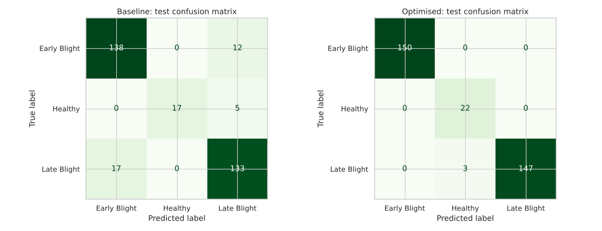
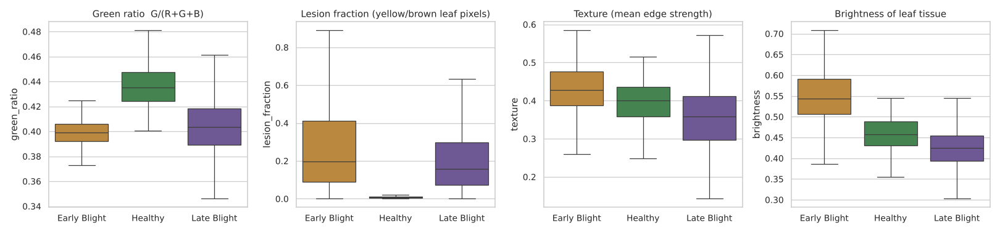
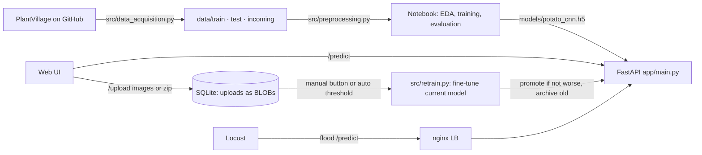
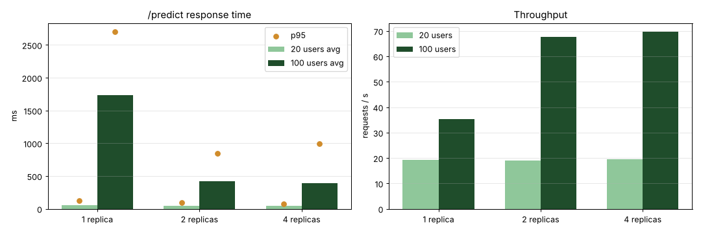

# LeafCheck: Potato Leaf Disease Classification (End-to-End MLOps Pipeline)

An image classifier that tells from one photo of a potato leaf whether the plant is **Healthy**, has
**Early Blight** or has **Late Blight**. It is served through a FastAPI service with a web UI that shows model
up-time, data insights, single-image prediction, bulk data upload and one-click retraining. The service is
deployed on Render with Docker and load-tested with Locust.

| | |
|---|---|
| 🎥 **Video demo** | **[YouTube link](https://youtu.be/REPLACE_ME)** |
| 🌐 **Live app** | **https://REPLACE-ME.onrender.com** (API docs: `/docs`) |
| 📓 **Notebook** | [`notebook/potato_disease_mlops.ipynb`](notebook/potato_disease_mlops.ipynb) |
| 🧠 **Model file** | [`models/potato_cnn.h5`](models/potato_cnn.h5) (Keras HDF5) |

---

## 1. Project description

**Problem.** Irish potato is one of Rwanda's main staple and cash crops. Late blight (*Phytophthora infestans*) can
wipe out a field within days, and early blight (*Alternaria solani*) steadily cuts yields. Farmers and extension
officers need a fast first diagnosis from a phone photo, so they can act before the disease spreads.

**Data.** The potato subset of the open [PlantVillage dataset](https://github.com/spMohanty/PlantVillage-Dataset)
(Hughes & Salathé 2015, CC BY-SA 3.0): 2,152 RGB leaf images in 3 classes, split with a fixed seed into:

| split | Early Blight | Healthy | Late Blight | purpose |
|---|---:|---:|---:|---|
| `data/train` | 700 | 106 | 700 | model building (15 % carved out for validation) |
| `data/test` | 150 | 22 | 150 | held-out evaluation, never trained on |
| `data/incoming` | 150 | 24 | 150 | simulates **new field data** for the retraining demo (also zipped as `demo/new_field_data.zip`) |

**Model.** A custom CNN (4 conv blocks with BatchNorm, GlobalAveragePooling, dense head) with data augmentation,
L2 weight decay, dropout, the Adam optimiser, early stopping, learning-rate scheduling and class weights for the
small *Healthy* class. Compared against a vanilla CNN baseline on the held-out test set:

| Metric (test set, 322 images) | Baseline CNN | **Optimised CNN (v1)** |
|---|---:|---:|
| Accuracy | 89.44 % | **99.07 %** |
| Loss (cross-entropy) | 0.305 | **0.025** |
| Precision (macro) | 0.926 | **0.960** |
| Recall (macro) | 0.860 | **0.993** |
| F1 (macro) | 0.888 | **0.975** |
| F1 (weighted) | 0.894 | **0.991** |
| ROC-AUC (one-vs-rest) | 0.977 | **0.9998** |



The only 3 test errors are late-blight leaves with very early, faint lesions that were predicted as healthy.

### Dataset insights: what story do the features tell?



1. **Green ratio G/(R+G+B):** healthy leaves are greener (median 0.435 vs ≈0.40), because disease destroys
   chlorophyll. This splits healthy from diseased, but not one blight from the other.
2. **Lesion fraction:** healthy leaves have ≈1 % yellow/brown tissue, blighted leaves 16–20 % (median). This is the
   strongest single signal of disease.
3. **Texture (edge strength):** early blight's concentric "target" spots give the busiest surface (0.43). Late
   blight's large, smooth, water-soaked patches give the smoothest (0.36). **Texture is what separates the two
   blights.**
4. Class distribution: only 7 % of images are healthy, so the model is trained with class weights and judged on
   macro-F1.

No single feature separates all three classes. A CNN that learns colour and local texture at the same time is the
right tool. The same charts are live in the UI's **Data insights** tab.

---

## 2. Architecture



## 3. Repository structure

```
potato_disease_mlops/
├── README.md
├── notebook/
│   └── potato_disease_mlops.ipynb   # preprocessing, training, 7 evaluation metrics, prediction & retraining demo
├── src/
│   ├── preprocessing.py             # decode → RGB → resize 128 → uint8; zip extraction; directory loading
│   ├── model.py                     # baseline + optimised CNN, training, evaluation metrics, save/load (.h5)
│   ├── prediction.py                # Predictor with hot-reload of new model versions
│   ├── retrain.py                   # retraining pipeline + manual / auto-threshold / CLI triggers
│   ├── database.py                  # SQLite: uploads (images as BLOBs), training runs, prediction log
│   ├── data_acquisition.py          # download + stratified split
│   ├── insights.py                  # interpretable features for visualisations
│   └── config.py
├── app/
│   ├── main.py                      # FastAPI service
│   └── static/                      # web UI (HTML/CSS/JS + Chart.js)
├── data/
│   ├── train/   ├── test/   └── incoming/
├── models/
│   ├── potato_cnn.h5                # trained model
│   ├── metadata.json                # version, test metrics, version history
│   └── insights.json
├── locust/locustfile.py + results/  # load-test script and CSV results
├── demo/                            # sample images to predict + zip of new data for retraining
├── Dockerfile · docker-compose.yml · nginx.conf · render.yaml
└── requirements.txt · requirements-dev.txt
```

---

## 4. Setup

### 4.1 Run locally (Python 3.11 – 3.13)

```bash
git clone https://github.com/<your-username>/potato_disease_mlops.git
cd potato_disease_mlops
python -m venv .venv && source .venv/bin/activate        # Windows: .venv\Scripts\activate
pip install -r requirements-dev.txt

# (optional) re-download and re-split the data; it is already included in data/
python -m src.data_acquisition

# (optional) retrain from scratch: run the notebook top to bottom (~20 min on a laptop CPU)
jupyter notebook notebook/potato_disease_mlops.ipynb

# start the API + UI
uvicorn app.main:app --port 8000
```
Open **http://localhost:8000** for the UI and **http://localhost:8000/docs** for Swagger.

### 4.2 Run with Docker

```bash
docker build -t leafcheck .
docker run -p 8000:8000 leafcheck
```

Several containers behind an nginx load balancer (used for the load tests):

```bash
docker compose up --build -d --scale api=2      # 1, 2, 4 ...
docker compose restart lb                       # after changing the scale
# app on http://localhost:8080
```

### 4.3 Deploy on Render (cloud)

1. Push this repo to GitHub.
2. In Render: **New → Blueprint**, then select the repo. `render.yaml` creates a Docker web service with the health check on `/health`.
3. Wait for the build (≈5–8 min, TensorFlow is large). Open `https://<service>.onrender.com`.
4. Paste the URL at the top of this README.

Notes:
* **Instance size.** Measured memory: ~0.7 GB while serving (TensorFlow alone takes ~620 MB on import) and
  ~1.3 GB peak while retraining. Render's 512 MB free/starter instances would run out of memory, so `render.yaml`
  uses the **Standard** plan (2 GB). Billing is prorated, so suspend the service after grading.
* **Persistence.** The instance disk is ephemeral: uploads and retrained versions reset when the service restarts or
  redeploys. For persistence, attach a Render Disk as shown in `render.yaml`. The app copies the bundled model onto
  the empty disk on first boot.

### 4.4 Configuration (environment variables)

| variable | default | meaning |
|---|---|---|
| `RETRAIN_THRESHOLD` | 100 | pending uploaded images that **auto-trigger** retraining |
| `AUTO_RETRAIN` | true | enable the automatic trigger |
| `REPLAY_PER_CLASS` | 120 | original images per class mixed into each retraining run |
| `RETRAIN_EPOCHS` / `RETRAIN_LR` | 8 / 1e-4 | fine-tuning budget |
| `PROMOTION_TOLERANCE` | 0.01 | new model may be at most 1 accuracy point worse than the current one |
| `DB_PATH`, `MODELS_DIR` | `data/app.db`, `models/` | point to a persistent disk in production |
| `WEB_CONCURRENCY` | 1 | uvicorn worker processes per container |

---

## 5. Using the app

| Feature | Where | API |
|---|---|---|
| **Model up-time** and status | Dashboard (refreshes every 5 s) | `GET /health` |
| Model metrics and version history | Dashboard | `GET /model` |
| **Evaluate the model in production** | Dashboard → *Run evaluation* | `POST /evaluate` (optional labelled zip) |
| Live traffic monitoring (confidence, latency p50/p95, class mix) | Dashboard | `GET /monitoring` |
| **Predict one image** | Predict tab | `POST /predict` |
| **Data visualisations** (3+ features with interpretation) | Data insights tab | `GET /insights` |
| **Bulk upload** (many images or zip) → saved to database | Upload & retrain tab | `POST /upload` |
| **Trigger retraining** (button) | Upload & retrain tab | `POST /retrain`, `GET /retrain/status` |

**Prediction demo:** upload any file from `demo/predict_samples/`. The file name is the true label.

**Retraining demo:** upload `demo/new_field_data.zip` (324 new images; labels come from the folder names), then click
**Retrain model**.

### Retraining pipeline (`src/retrain.py`)

1. **Upload + save to database:** each image is validated with the training preprocessing and stored as a BLOB in
   SQLite (`uploads` table), de-duplicated by SHA-256.
2. **Preprocess** the pending uploads (decode → RGB → resize 128 px).
3. Add a **replay sample** of the original training data so the model does not forget what it already knows.
4. **Load the current production model (the custom pre-trained model) and fine-tune it** with Adam (lr 1e-4), class
   weights and early stopping.
5. **Evaluate old vs new** on the untouched test set. **Promote** the new version only if it is not worse; the old
   `.h5` goes to `models/archive/`. All API workers hot-reload the new file.
6. Every run is logged in the `training_runs` table and shown in the UI.

**Triggers:** (a) manual button / `POST /retrain`, (b) **automatic** once pending uploads ≥ `RETRAIN_THRESHOLD`,
(c) CLI or cron: `python -m src.retrain --load-dir data/incoming`.

Verified end to end: uploading `new_field_data.zip` and retraining promoted **v2** (test accuracy 99.07 % → 99.07 %,
macro-F1 0.975 → 0.981). An automatic run triggered by a later upload promoted **v3**.

---

## 6. Flood request simulation (Locust)

```bash
# against the cloud deployment (interactive dashboard on http://localhost:8089)
locust -f locust/locustfile.py --host https://<service>.onrender.com

# headless, e.g. against docker compose with N containers
locust -f locust/locustfile.py --host http://localhost:8080 --headless -u 100 -r 20 -t 60s --csv locust/results/c2_u100
```

Each simulated user sends a random test-set leaf image to `/predict` (plus an occasional `/health`) about once
per second. Each test ran 60 s with 20 and 100 concurrent users, against 1, 2 and 4 API replicas
(each replica = 1 uvicorn process limited to 1 TensorFlow thread, i.e. roughly 1 CPU, like one container).

| Replicas | Users | Requests | Failures | Avg (ms) | Median (ms) | p95 (ms) | Throughput (req/s) |
|---:|---:|---:|---:|---:|---:|---:|---:|
| 1 | 20 | 1,051 | 0 | 55 | 39 | 120 | 19.2 |
| 2 | 20 | 1,021 | 0 | 48 | 38 | 93 | 19.0 |
| 4 | 20 | 1,048 | 0 | 45 | 37 | 79 | 19.4 |
| 1 | 100 | 1,892 | 0 | **1,735** | 1,700 | 2,700 | **35.3** |
| 2 | 100 | 3,643 | 0 | **425** | 400 | 850 | **67.7** |
| 4 | 100 | 3,747 | 0 | **393** | 320 | 990 | **69.7** |



**Interpretation**
* At **20 users** one replica copes easily: ~40 ms median and no queueing, so extra replicas only trim the tail
  (p95 120 → 79 ms).
* At **100 users** a single replica is **saturated** at ~35 req/s. Requests queue and average latency jumps to
  1.7 s. **Two replicas double throughput (67.7 req/s) and cut average latency 4×.**
* Going from 2 to **4 replicas** adds almost nothing, because the test machine has only **2 vCPUs** (shared with
  Locust itself). Scaling out only helps while there is spare CPU, so on Render you would scale instances, each
  with its own CPU.
* **0 failures** in every run.

> These runs used uvicorn worker processes on a 2-vCPU machine as replicas. Docker Hub was unreachable from the
> build machine, so containers could not be built there. To reproduce with real containers, run
> `docker compose up -d --scale api=N` and the headless Locust command above. Raw CSVs are in `locust/results/`.

---

## 7. Notebook contents

1. Data acquisition and split
2. EDA: sample images, image properties, class imbalance, 4 interpretable features with interpretations
3. Preprocessing: decode, EXIF fix, RGB, resize, in-model rescaling and augmentation, stratified split, class weights
4. Model creation: vanilla baseline vs optimised CNN (augmentation, BatchNorm, L2, dropout, GAP, Adam,
   EarlyStopping, ReduceLROnPlateau, class weights), learning curves
5. Evaluation: accuracy, loss, precision, recall, F1 (macro and weighted), ROC-AUC, confusion matrix,
   classification report, ROC curves
6. Prediction functions (`Predictor`), including the exact JSON returned by the API
7. Retraining demonstration: fine-tuning the saved model on `data/incoming`

## Credits

PlantVillage dataset: D. Hughes & M. Salathé (2015), *An open access repository of images on plant health…*,
arXiv:1511.08060, CC BY-SA 3.0.
